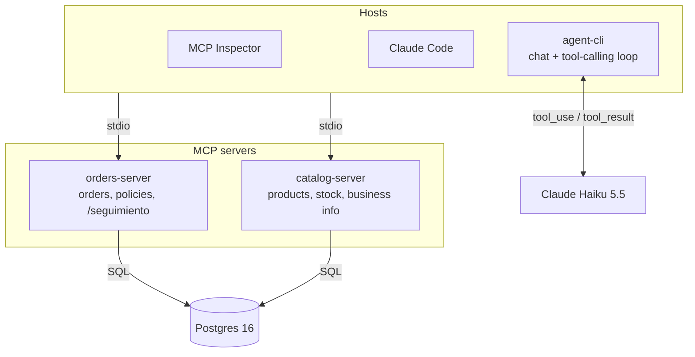

# retail-orders-mcp

A customer-service chat for a fictional hardware store, built **fully locally** to learn how to build [Model Context Protocol](https://modelcontextprotocol.io) servers and a custom AI agent host from scratch in TypeScript.

Customers ask about their orders and products in natural language; an LLM decides which tools to call, and the host executes them against MCP servers backed by Postgres.

```text
You   > how's my order 1042?
  ↳ search_orders {"text":"1042"} → ok 18ms
Agent > Your order 1042 is out for delivery and should arrive tomorrow between 10 and 14 h.
```

> This is a learning project. The store, customers and data are fictional.

## What this project demonstrates

- **MCP servers** in TypeScript using all three primitives: tools, resources (static and templated) and prompts with argument completion.
- **A custom agent host** (`agent-cli`): MCP client, tool-calling loop with Claude, iteration limits and tool-call logging, with no agent framework.
- **Tool design for LLMs**: task-oriented tools, descriptions written for the model, business errors returned as `isError` results the model can explain.
- **Per-customer authorization** enforced by the server, never by the model: the customer identity is injected by the host and is not a tool argument.
- **Protocol-level tests**: Vitest suites that talk to the servers as an MCP client over an in-memory transport, without an LLM.

## Architecture



The same servers are exercised from three hosts. Only `agent-cli` talks to the LLM: the model proposes a tool call, the host executes it over MCP and feeds the result back.

## MCP surface

| Server | Primitive | Name | Purpose |
| --- | --- | --- | --- |
| orders-server | Tool | `search_orders` | Find a customer's order from free text (number and/or product) |
| orders-server | Tool | `get_order_status` | Status, ETA, total and items of one order |
| orders-server | Tool | `list_my_orders` | Customer's orders, optionally filtered by status |
| orders-server | Resource | `orders://policies` | Shipping, cancellation and return policies |
| orders-server | Prompt | `seguimiento` | Order follow-up workflow, with order-number completion |
| catalog-server | Tool | `search_products` | Search products by name, category or description |
| catalog-server | Tool | `check_stock` | Available units for a SKU |
| catalog-server | Resource | `business://info` | Opening hours, address, payment methods |
| catalog-server | Resource | `catalog://categories` | Product categories |
| catalog-server | Resource template | `catalog://products/{sku}` | Product sheet |

## Security model

- **The LLM proposes, the host decides, the server validates.** No business rule depends on the model behaving.
- The customer ID is set by the host when launching the server (stdio) and is **never** a tool argument, so the model cannot query another customer's data.
- An order that belongs to another customer is indistinguishable from one that does not exist.
- Argument completion is also filtered by customer.
- Tool results are treated as data, not instructions.

## Getting started

**Requirements:** Node 20.12+, pnpm, Docker, and an [Anthropic API key](https://console.anthropic.com) for `agent-cli`.

```bash
git clone https://github.com/pipeddev/retail-orders-mcp.git
cd retail-orders-mcp
cp .env.example .env          # add your ANTHROPIC_API_KEY
pnpm install
pnpm db:up                    # Postgres + schema + seed
pnpm db:smoke                 # should list 8 orders
```

**Chat with the agent**

```bash
pnpm --filter @retail-orders-mcp/agent-cli chat
```

**Inspect a server**

```bash
pnpm --filter @retail-orders-mcp/orders-server inspect
pnpm --filter @retail-orders-mcp/catalog-server inspect
```

**Use it from Claude Code**: the repo includes a `.mcp.json`. Run `claude` from the repo root, approve the servers and type `/mcp`.

**Run tests**

```bash
pnpm typecheck
pnpm --filter @retail-orders-mcp/orders-server test
```

### Seed customers

| ID | Customer | Orders |
| --- | --- | --- |
| 1 | Camila | 1040 (delivered), 1042 (shipped), 1044 (pending) |
| 2 | Diego | 1043 (paid), 1045 (cancelled) |
| 3 | Valentina | 1046 (pending) |
| 4 | Matías | 1047 (delivered) |
| 5 | Fernanda | 1048 (paid) |

Change `CUSTOMER_ID` in `.env` (or `.mcp.json`) to act as a different customer.

## Project structure

```text
retail-orders-mcp/
├── db/                       # schema.sql + seed.sql (run by Postgres on first start)
├── packages/
│   ├── shared/               # Postgres pool, domain types, formatting
│   ├── orders-server/        # MCP server: orders
│   ├── catalog-server/       # MCP server: catalog
│   └── agent-cli/            # MCP host: terminal chat + tool-calling loop
├── docker-compose.yml
└── .mcp.json                 # Claude Code configuration (local dev credentials only)
```

## Stack

TypeScript · Node.js · [`@modelcontextprotocol/sdk`](https://github.com/modelcontextprotocol/typescript-sdk) · Zod · PostgreSQL 16 (pgvector image) · Anthropic SDK (Claude Haiku 5.5) · Vitest · pnpm workspaces

## Roadmap

- [x] **Phase 1:** First MCP server over stdio, tested from MCP Inspector and Claude Code
- [x] **Phase 2:** All three primitives: tools, resources, prompts
- [x] **Phase 3:** Custom host: MCP client + tool-calling loop
- [ ] **Phase 4:** Multi-server host; `create_order` / `cancel_order` with human confirmation
- [ ] **Phase 5:** Streamable HTTP transport with per-customer bearer tokens (NestJS)
- [ ] **Phase 6:** Evals: tool-selection accuracy on a dataset of real customer questions
- [ ] **Phase 7:** Prompt injection and tool poisoning, attacks and defenses
- [ ] **Optional:** Semantic product search with pgvector (RAG)

## Design decisions

| Decision | Why |
| --- | --- |
| One MCP server per domain | Practice multi-server hosts; mirrors separate real systems |
| Customer identity injected by the host | A tool argument is controlled by the LLM and can be manipulated |
| Business errors as `isError` results, not exceptions | The model can read the error and explain it to the customer |
| Plain SQL with `pg`, no ORM | Make every query a tool runs explicit |
| Custom host instead of an agent framework | Understand the full loop before abstracting it |
| No build step (`tsx` + `tsc --noEmit`) | Less tooling for a local learning project |

## License

MIT